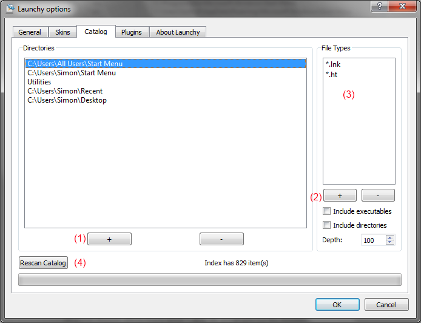
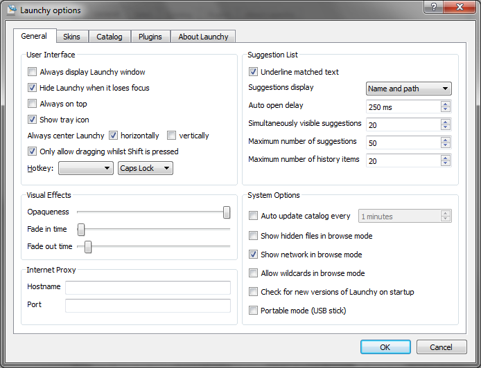

# Launchy 2.5.1

# PLEASE READ THIS!

When Launchy runs it disappears to the background.  You have to press ‘alt+space’ (control+space in Linux) in order to see Launchy.  If Launchy is new for you please read the rest of this short manual.

# Welcome

Launchy was first created for my own use, but as my friends and I began to heavily rely upon it and its lack of cost, I decided to distribute it.  The official homepage for Launchy is [http://www.launchy.net](http://www.launchy.net/).  If you need help using Launchy or would like to leave any comments/suggestions please feel free to post on the forums.

-- Josh Karlin

# What is Launchy?

Launchy is the most efficient way to open files, folders, websites, and programs on your computer.  Nobody likes to hunt through the start menu to find an application, just to find that the application is hidden under some obscure folder named after a company you have never heard of!  Instead, Launchy is a smart search program which tries to guess which program or file you are looking for and will launch it when you hit the enter key.  It is only visible when you hit the alt+space key combination; otherwise it hides in the background.  Once you have used it for a few days, it becomes an indispensable utility for your computer.  And it’s free!

# How to use Launchy

Launchy installs itself into your Startup folder (it’s buried in your start menu) and will automatically run every time you log into your computer.  Yet, where is it?  Launchy hides in the background until you need it.  To bring it to the foreground type alt+space (hold down the alt key and tap the space bar).  At this point simply begin typing the name of the program you are looking for.  Do not worry about capitalization, punctuation, or even spelling in general.

Chances are, Launchy knows what you are looking for.  Launchy will show you what it thinks you are looking for in the right hand box, and if it has found what you want, hit enter to launch that program.  If it has not found what you are looking for stop typing for a second and Launchy will show you a list of alternative suggestions to choose from.  Then hit enter to launch that program.

If you strike the enter key, Launchy will launch the requested program and then disappear again until you need it next.  If you have changed your mind and do not wish to launch a program, you can hit alt+space to make it disappear again or you can simply hit the escape key.

If you would like to change the skin, add new directories and file types for Launchy to scan, or change the hotkey, right click on Launchy anywhere outside of the text areas and select “Options”.  Some skins have an options button on them.

## Command Line Parameters

Launchy allows you to add additional command line parameters onto your queries.  Simply hit tab once you have found the application you are interested in and then enter them.

For instance, type in “fire” for Firefox and once Firefox is selected, hit tab and then enter [www.launchy.net](http://www.launchy.net/) followed by the enter key.

## Command History

When the input text area is empty, press the down arrow and Launchy will display a history of the commands you’ve entered. You can scroll up and down the list and press enter to repeat the command. Pressing Shift+Delete will remove the item from the history.

## Browsing the File System

Type directory path and Launchy will display a list of the files and directories within that directory. Launchy will filter and sort items based on what you’ve typed so you can narrow down the list until you’ve found what you want. To expand the file or directory to its full name, hit tab or slash.

Typing \\\\ will list the machines available on the network.

On Windows, typing a \\ will list the drives available on the system.

## Adding Directories and Types

If you would like Launchy to index more than the programs in your start menu, such as folders, mp3s, docs, pdfs, avis, then select the Catalog tab.

### Adding Directories

Right click on Launchy and select options and then go to the Catalog tab.  Add the directories you would like Launchy to scan by hitting the “+” button (1 on the picture). You can also drag and drop folders from Windows Explorer onto the folder list.

### Adding File Types

You can specify which file types to search for in each directory, such as \*.mp3 in your music directory and \*.jpg in your pictures folder.

To add a file type to a directory, select the directory, click the “+” button (2) and enter the file type (such as \*.mp3) in the edit box that appears in the file types list (3).

To add all of the files in a directory, add ‘\*.\*’ as a type.

To index all programs in a directory, check the “Include executables”

Launchy can also index the names of sub-directories.  Check the “Directories” box to add sub-directories as a type to index.

You can rescan your index at any time by going to the options menu, going to the “Catalog” tab and clicking the “Rescan Catalog” button at the bottom.

## How to Change the Hotkey

Right click on Launchy anywhere outside of the text areas and choose Options and then go to the “General” tab.  From within, choose whichever hotkey suits you.  The original is Alt + Space in case you would like to return to it later.

## Skins

It is possible to skin Launchy.  To create a skin, look in the “Skins” directory under your installation directory and copy the “Default” skin into a new directory.  Edit the skin.qss and misc.txt files to your liking and replace the images.  You can also find new skins from the main website: [http://www.launchy.net/](http://www.launchy.net/)

## Plugins

Launchy is very extensible due to its plugin architecture.  See the *Official Plugins* section to see what plugins are provided with Launchy.  If you would like to turn plugins on or off, right click on Launchy and go to the Plugins menu.  Simply uncheck each plugin that you would like to disable.

Some plugins have customizable options, such as Runny.  To configure a customizable plugin, select the plugin and click on the “Plugin Options” button.  If the plugin is not customizable the button will be grayed out.

## How to close Launchy

Right click on Launchy anywhere outside of the text areas and select Exit.  Some skins have an exit button on them.

# Official Plugins

Launchy supports plugins.  In the “Plugin” directory in your Launchy installation folder you will find plugins.  They are .dll files that can be added or removed as you like.

Plugins can be configured in the options screen.  Go to the “plugins” tab and select the plugin that you are interested in.  To disable a plugin, uncheck it.  To configure a plugin, select it and if any configurable options are available a set of options will appear.

## Runner Plugin

### Run Custom Commands

Create aliases for your favorite commands, even those that require user input.  For instance, create the command “mailto: $1” with the alias of “email” .  Then, when you type “email” into Launchy, hit tab, and then type the email address the email address will replace the $1 and your email client will launch.

Another example might be [http://www.google.com/search?q=$$](http://www.google.com/search?q=$$).  Or perhaps “c:\\bin\\mycommand.bat”

### Build your own commands

Right click on Launchy, go to Plugins, select Runny, and hit the plugin options button.  Here you can add your own commands.  For command name enter the alias that you would like to use for your command.  In the execute entry place your command line program.  You can place $1,$2,$3 etc.. in your path where you would like to have user input or just $$ for all user input.

## Calcy Plugin

### Calculate

Type in some simple math. Launchy will calculate the answer. The calculator is limited to +,/,-,\* and parenthesis.

## Controly Plugin

### Index Control Panel Applications

This plugin finds the control panel applications in your system and lists them in Launchy.

## GCalc Plugin (gcalc.dll)

### Calculate & Convert

GCalc queries Google for answers.  So if you type “gcalc \<tab> 4+4” and wait a split second, Google will respond with “8”.  It's very smart however, and you can ask things like “gcalc \<tab> 4 dollars in euros” or “gcalc \<tab> 3 tsp in tbsp”

## Verby Plugin

### Open containing folders and more

Verby adds additional commands to items in the index. For example, typing “notepad” \<tab> will allow you to open the containing folder, view the file properties, or copy the path to the program to the clipboard. If you just want to run the program, choose run.

## Weby Plugin

### Perform Web Searches

Launchy supports the following search keywords: google, bing, yahoo, weather, amazon, wikipedia, dictionary, thesaurus, imdb, netflix, and msdn websearch.  Type in any of these keywords, hit tab, type in your search query, and hit enter.

### Set a default search engine

With this option, if Launchy cannot find a solution to your query, it will offer to search for it with your favorite website (defaults to google).  To select a different default search site, select your favorite site from the weby plugin configuration dialog and hit the “Set Default” button.  To disable this feature, simply hit the “Clear Default” button.

### Launch Webpages

Type in the url such as ‘www.launchy.net’ or ‘http://www.launchy.net’ and hit enter

### Firefox 3

Firefox 3 stores bookmarks in a locked database that Launchy can't access.  To enable Launchy to scan your Firefox bookmarks, please type “about:config” in your Firefox url bar, find the entry “browser.bookmarks.autoExportHTML” and double click on it to set it to “true”.  Close the tab and rebuild your Launchy catalog, and you should have your bookmarks.

# General Options

### User Interface

### Always display Launchy window

Rather than hiding after you run a program, Launchy will always remain visible and pressing the hotkey will not hide Launchy when it has keyboard focus.

### Hide Launchy when it loses focus

Hides Launchy when keyboard focus is lost to another application.

### Always on top

Keeps Launchy visually on top of all other programs.

### Always center Launchy

Each time you press the Launchy hotkey, Launchy will appear in the center of the screen in the selected axes.

### Only allow dragging whilst Shift is pressed

Check this option to prevent accidentally moving Launchy with the mouse.

### Hotkey

Allows you to choose another Launchy hotkey (alt+space is the default).

### Suggestions List

### Underline matched text

Highlights the characters that Launchy has used to choose the items it has matched.

### Suggestions display

Allows you to choose what information to display about each item in the suggestions list.

### Auto open delay

Determines how long Launchy waits after you stop typing before it shows the suggestion list.

### Simultaneously visible alternate suggestions

In the dropdown box of suggestions, how many would you like to see at once?

### Maximum number of alternate suggestions

This is ignored when browsing the file system.

### Maximum number of history items

Determines how many previously entered commands to remember.

### Visual Effects

### Opaqueness

Sets the level of Launchy’s transparency.

### Fade in time

Sets the duration for Launchy’s fade in animation

### Fade out time

Sets the duration for Launchy’s fade out animation

### Internet Proxy

If you’re stuck behind a corporate proxy server, enter its details here to enable GCalc and any other plugins that need a connection to the internet.

### System Options

### Minutes between catalog updates

Sets how often Launchy’s index is rebuilt.  Every 10 minutes is the default, but you can customize this.  Set it to 0 if you only want to scan manually.

### Show hidden files in browse mode

When browsing files, (e.g. by typing c:\\ in windows), should hidden files be made visible?

### Show network files in browse mode

When browsing files, this setting determines whether Launchy attempts to show files on the network.

### Check for new versions of Launchy on startup

Launchy will check to see if a new version of Launchy is available each time Launchy starts running.

### Portable mode (USB stick)

Launchy stores its configuration files in user-specific locations.  When in portable mode, Launchy will store its configuration files in the directory that it is run from.  To run Launchy in portable mode, follow this procedure:

### Install Launchy Normally

Copy the Launchy directory to your usb stick

Run Launchy from the usb stick

Check the “Portable Mode” box in the General options tab

Exit Launchy

Note: Launchy periodically rebuilds the index.  If you move from computer to computer the index might not be reflective of the machine it is currently residing on.  It would be a good idea to right click and “Rebuild Index” when you plug into a new computer.

## Keyboard Shortcuts

| Shortcut | Action |
| --- | --- |
| Escape | Hide alternatives list then hide Launchy |
| Enter | Launch selected item |
| Shift+Ctrl+Enter | Launch selected item elevated (Windows only) |
| Tab | Enter additional command parameters |
| Shift+Tab Shift+Backspace | Delete back to the previous Tab position |
| Ctrl+, | Show the options dialog |
| F5 | Rescan the catalog |
| Shift+F5 | Reload the current skin |

## Command Line Switches

Launchy understands the following command line switches

| Switch | Description |
| --- | --- |
| exit | Attempt to close any running instances of Launchy |
| multiple | Allows more than one instance of Launchy to run. |
| options | Shows the options dialog |
| profile | Specify a different settings and catalog profile to load |
| rescan | Rescan the catalog |
| rescue | Resets Launchy’s position to the center of the screen and selects the default skin |
| show | Shows Launchy’s window (default is to launch hidden in most cases). Can be used as a way to active Launchy from a shortcut. |

If /multiple is not used and Launchy is already running, then the command will be sent to the running instance of Launchy.

Examples

Launchy.exe /show

Launchy.exe –rescan

Launchy.exe /profile Secondary

### Profiles

Profiles allow you to have separate settings and catalog using a single Launchy installation. When you specify a profile name, Launchy loads its settings from the profiles/\<profile> directory. If the directory doesn’t exist, Launchy creates it with default settings as if it was a new install. Possibly uses:

1. Running more than one Launchy at the same time with different catalogs and different hotkeys.
2. When using portable mode, having a different settings and catalog depending on the computer that Launchy is running on. To do this, start Launchy with the following command line:
   *Launchy.exe /profile %COMPUTERNAME%*

Known Linux Issues:

Not all skins will work with Linux Launchy.  If you're running a compositing manager (compiz/beryl) then the skins should look the same as in Windows.  Otherwise, you will have to settle for the skins that look good without alpha transparency (e.g. Default and Black Glass).  If the black area of mask.png is perfectly rectangular then for some reason compiz won't mask it correctly and you will have a strange black section around the skin.

# Version Information

2.5.0

Added Simon Capewell as a developer. This release owes quite a lot to him.  Thanks Simon! ☺

Faster performance

Better behavior on Linux – Thanks Mike! (d9b5)

OS X now supported

Icons displayed correctly

Environment variables updated correctly when system changes

Controly includes more items, thanks Fabian!

New shortcut keys

New controls:

Shift+tab or Shift+bkspc deletes previous tab

Shift+Ctrl+Enter launches in elevated mode (Vista and Win7)

Down arrow shows history (when there is no current search text)

Default skin built into executable in case no other skin is found

Launchy now has an icon in the system tray

Skins are simplified and easier to create

Directory browsing auto-completes correctly

2.1.0

Added Linux support! (KDE and Gnome both work, possibly others)

Added Google Calculator plugin (gcalc)

Added configurable default search to weby (all searches with no results default to google)

“/” and “\\” now tab complete while file browsing

Added rescue mode to recover lost windows or forgotten hotkeys (in Linux run “launchy rescue” or use the start menu in windows)

Minimum transparency set to 15%

Searches are even faster and the catalog uses slightly less memory

Bug Fixes:

Fixed the database update timer

Fixed centering problem when multiple monitors in use

Fixed the url encoding problem, e.g. googling for “c#” now works

2.0.0

Launchy has been *completely* rewritten with QT

Your old plugins/skins will no longer work

Your old configuration will be wiped

A new look!  New icons and skin thanks to Tyler Sticka

Much better skinning support

Options merged into a single, tabbed dialog

Skin selection now shows previews

Plugins much more configurable

Launchy can hide when it loses focus

Fade in/out effects

Customizable transparency

Optional shallow scan of directories

Unicode support for Firefox bookmarks

Vista support

It’s just better.

1.2.5

New control panel plugin (indexes control panel apps)

Runny plugin (customizable commands)

Notification of new Launchy Releases (can be turned off)

Command line argument support (hit tab and type the arguments)

Can use ‘.\*’ as a filetype for directories

Plugins can be enabled/disabled (right click on launchy, go to plugins)

Plugins can now have configurable options

Always on top is now configurable

Bug Fixes:

Removed startup crash bug

Fixed Weby bug (it was hard to select Google)

Fixed mouse disappearance in dropdown menu

Launchy no longer jumps when you change skins

Launchy no longer flashes on startup

Calcy took priority over files with numbers, fixed

Launchy can now be placed in the corner of the screen

1.0.0

Launchy now supports plugins!  Check out the “Plugins” folder inside your Launchy directory, you can add and remove plugins from there when Launchy is not running.  Following are the plugins that come with Launchy by default, I expect many others to be developed by myself and the community.

**Explory Plugin**: A file explorer for Launchy!  Now you can use launchy to navigate your filesystem.  Try typing “c:” then hitting tab, keep on typing and hitting tab!

**Weby Plugin**: Supports launching of url’s and adds quick launches for “Google” “MSN” “Amazon” and many others, try typing “google” then hit tab then type in a search query

**Foxy Plugin:** With foxy your Firefox bookmarks will be added to the Launchy index.  Even better, your firefox keywords are added to Launchy and behave like quick launches do for Weby.  Not sure what firefox keywords are?  Go here: http://www.mozilla.org/products/firefox/smart-keywords.html (Note some firefox quick searches are currently incompatible and will not be indexed)

**Calcy Plugin:**  Never have a calculator handy?  With Calcy, Launchy knows when you’re trying to do math and will display the result in the suggestions box.  For instance, try typing in “(4 + 3) \* 12” and 84 will result in the suggestions box.  Support for + - \* / ()’s currently exists.

Now Ctrl+Backspace deletes a word at a time and Alt+Backspace clears the text

Too many bug fixes to count or remember, good riddance!

Special thanks to Sean Poon [http://gakuseisean.deviantart.com](http://gakuseisean.deviantart.com/) for the use of his wonderful icons for the plugins

1.0.0 Beta

Launchy displays the full path and icon to files in the dropdown suggestions box.

Filetypes can now be specifically set for each directory to index

Always on top mode added

USB Mode added

Configurable index scan interval

Configuration files moved to docs and settings\\username\\Applications\\Launchy\\ which is friendlier to users with limited access accounts.

Bug Fixes:

The Launchy startup on auto-login crash should be gone

No longer presumes icon index is located in C:\\

Hotkey window now initializes with current hotkey

Configuration files now less likely to be corrupted due to restart during saving

0.9.6

Launchy can now index directory names as well as files!

A utilities folder with useful shortcuts is now included, it adds standard control panel programs, system shutdown / logoff/ reboot, and special folders such as My Documents, and My Music.

Unicode now fully supported.  All character sets should work.

The old style of matching by association is completely removed, it’s now entirely based upon frequency of use

Now has a “please donate” dialog that appears only once, sorry but I’ve got to make a living!

Bug Fixes:

Fixed up/down keys causing a dropdown when there are no matches

Saves settings to ini directly after changes are made in case of system crash

Spaces are now ignored in user input, making it possible to search for “Johnny\_cash.mp3” with “john cash”

0.9.3

Once again, Launchy is prettier.  The combobox has vanished.

New skins!  Please see the Author.txt file in each skin’s directory to give credit where credit is due.

Bug Fixes:

Sometimes windows shutdown prevented the database from being saved.  Now it saves more frequently just in case.

Arbitrarily long file extensions are now allowed, so you can filter on .mpeg for instance and not just .mpg

A couple of minor graphical glitches have been fixed

Development Environment:

The Boost library is no longer needed to compile Launchy, I’ve copied the necessary Boost header files for smart pointers into the project.

0.9.2

Frequency sorting took priority over exact matches, fixed.

0.9.1

Search results sorted by frequency of use now.

Configuration files moved to the Users subdirectory of your installation.  This means that your configuration file will start fresh.. sorry!  It also means that Launchy can be run from a memory stick.

You can now remove the start menu from the directories you scan if you so desire.

Bug fixes, hooray!

0.9

Alpha channel support! Launchy is sexier now.

New skinning options.

Lots of skins!

Minor bug fixes.

Ability to rescan index on demand.

This is a feature complete version of Launchy 1.0  From now until then I will only post bug fixes.

0.81

New installer, after this release upgrades should be much better.

Added icon support.  Now icons are shown as well as the file name.  The visual cue of the icon makes for faster launching.  (It’s also prettier)

The combobox is now a bit more sane.  It won’t steal your focus away when it drops down.

Launchy will rescan directories on startup as opposed to waiting a couple of minutes.

Launchy now scans user specified directories and stores the results in a compressed file to make startup faster.

You can now change the hotkey that activates Launchy

You can now create/select skins for Launchy

Launchy searches \*much\* faster than before, enabling indexing of thousands of files

**0.7**  Launchy has memory!  It will associate your input with applications.

**0.61** Launchy no longer opens all programs maximized.

This is the first C++ release.  As I became frustrated with C#’s large .NET framework requirements and users lack of desire to install it, I decided to switch back to the faster language.  This release is functionally and visually equivalent to the 0.5 C# release.  The C# CVS version had some new features that I will soon add to the C++ branch.

**0.5** This was the first public release.
